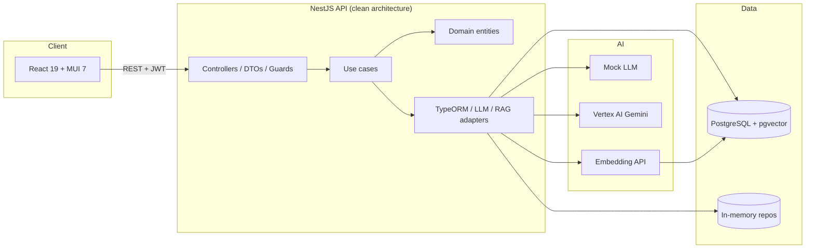

# Synthetic Market Research Platform

AI-powered market research simulator: define audience segments, generate synthetic personas, test product hypotheses with dual-process (System 1 / System 2) reasoning, and aggregate decisions with RAG-backed context.

Built as a portfolio-grade full-stack TypeScript system (React + NestJS + PostgreSQL/pgvector) with **clean architecture**, **offline mock LLM mode**, and **one-command local setup** — no cloud deployment required.

## Problem

Traditional concept tests and focus groups are slow and expensive. Product teams still need believable feedback on positioning, pricing, and messaging before they commit to builds. This platform approximates that loop by:

1. Encoding a target segment (demographics, psychographics, behaviors).
2. Generating diverse personas with an LLM (or deterministic mock responses).
3. Running each persona through a hypothesis simulation with retrieved market context (RAG).
4. Summarizing accept/reject rates, objections, and narrative insights.

## Architecture



| Layer | Location | Responsibility |
|-------|----------|----------------|
| Presentation | `backend/src/presentation` | HTTP, auth, validation, Swagger |
| Application | `backend/src/application` | Use cases (`execute` per action) |
| Domain | `backend/src/domain` | Entities, repository interfaces, AI/RAG ports |
| Infrastructure | `backend/src/infrastructure` | TypeORM, Vertex/mock LLM, pgvector RAG |
| Frontend | `frontend/src` | SPA routes, API client, results UX |

Deeper notes: [docs/ARCHITECTURE.md](docs/ARCHITECTURE.md) · [docs/HOW_IT_WORKS.md](docs/HOW_IT_WORKS.md)

## Key flows

1. **Segment → personas** — `POST /segments/:id/generate-personas` calls the LLM with segment criteria; personas persist for reuse.
2. **Hypothesis → simulation** — `POST /simulations` loads personas, queries RAG for market snippets, runs System 1 (gut) + System 2 (analytic) prompts per persona, stores decisions.
3. **Results** — Frontend simulation detail view shows distributions, objections, RAG sources, and export options.

## Quickstart (< 10 minutes)

**Prerequisites:** Node.js 20+, Docker (for Postgres), Git.

### One command

```bash
# Linux / macOS
./run-local.sh

# Windows
./run-local.ps1
```

### Manual

```bash
docker compose up -d

cd backend && cp .env.example .env && npm ci && npm run start:dev
# new terminal
cd frontend && cp .env.example .env && npm ci && npm run dev
```

| Service | URL |
|---------|-----|
| UI | http://localhost:5175 |
| API | http://localhost:3003 |
| Swagger | http://localhost:3003/api |
| Postgres | `localhost:5445` (user/password/db: `smr`) |

Default backend env uses **`LLM_MODE=mock`** and **`RAG_PROVIDER=inmemory`** — no API keys needed.

### First walkthrough

1. Open the UI → register a user (or use bootstrap admin if configured).
2. Create a **segment** (or seed demo data via admin seed endpoints when `SEED_ENABLED=true`).
3. **Generate personas** from the segment.
4. Create a **hypothesis** and run a **simulation**.
5. Open the simulation detail page for aggregated results and RAG citations.

## Configuration

See [docs/SETUP.md](docs/SETUP.md). Important variables:

| Variable | Default | Purpose |
|----------|---------|---------|
| `DB_ENABLED` | `true` | `false` = in-memory persistence (no Docker) |
| `LLM_MODE` | `mock` if no GCP project | `mock` or `vertex` (Gemini) |
| `GOOGLE_CLOUD_PROJECT` | empty | Required for `LLM_MODE=vertex` and pgvector embeddings |
| `RAG_PROVIDER` | `inmemory` | `pgvector` for real document retrieval |
| `VITE_API_BASE_URL` | `http://localhost:3003` | Frontend → API |

**Real Gemini locally:** enable Vertex AI, `gcloud auth application-default login`, set `LLM_MODE=vertex` and `GOOGLE_CLOUD_PROJECT`.

## Testing & CI

```bash
cd backend && npm ci && npm run lint && npm run typecheck && npm test && npm run build
cd frontend && npm ci && npm run lint && npm run test -- --run && npm run build
```

CI (`.github/workflows/ci.yml`) runs the same checks on push/PR with `DB_ENABLED=false`, `LLM_MODE=mock`, and in-memory RAG — no secrets.

**Strategy:** colocated Jest unit tests on use cases and guards (mocked repos/LLM); Vitest + Testing Library on the frontend API client and pages; E2E specs in `backend/test/` for local/integration runs (not required in CI).

## Design decisions

| Choice | Rationale |
|--------|-----------|
| Clean architecture | Domain stays framework-free; swap Postgres ↔ in-memory for demos vs persistence |
| pgvector in Postgres | One database for relational data + embeddings; avoids operating a separate vector DB for MVP scale |
| Mock LLM provider | Reviewers and CI run end-to-end without cloud accounts |
| Dual-process simulation | Separates fast heuristic vs deliberate reasoning — closer to behavioral research framing |
| JWT + roles | Simple auth model for admin/analyst mutations |

## Roadmap

- Workspace / tenant isolation and audit logging
- Richer results analytics (charts, cohort comparisons)
- Async simulation jobs with progress streaming
- Expanded RAG evaluation harness and corpus tooling
- Optional export to research report templates (PDF already partially supported)

## Documentation

- [docs/README.md](docs/README.md) — index
- [docs/ARCHITECTURE.md](docs/ARCHITECTURE.md)
- [docs/TECH_STACK.md](docs/TECH_STACK.md)
- [docs/RAG_IMPLEMENTATION_GUIDE.md](docs/RAG_IMPLEMENTATION_GUIDE.md)

## License

[MIT](LICENSE) — Copyright (c) 2026 Roman Abolmasov
