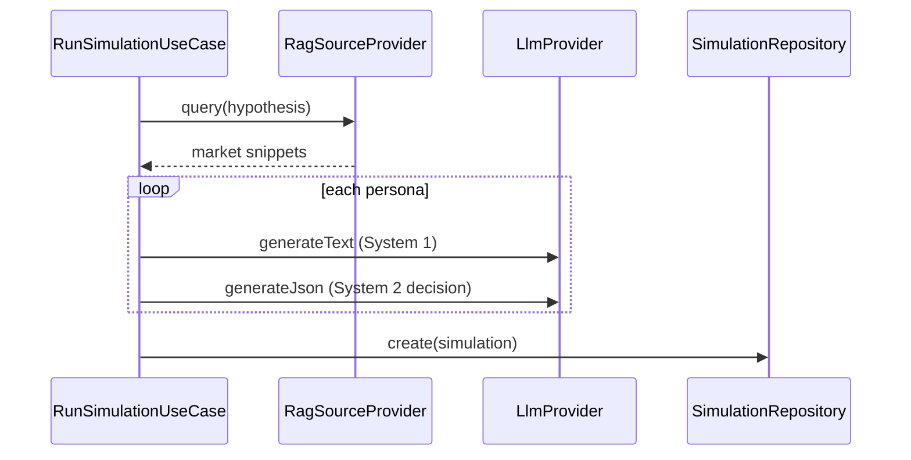

# Architecture

## System context

The platform supports product and research teams who want **synthetic respondents**: configurable segments, LLM-generated personas, and batch simulations against a stated hypothesis. Outputs include per-persona decisions, objection themes, and retrieved market context.

Everything runs as a **monorepo**: Vite SPA + NestJS API + optional Postgres (Docker Compose).

## Layered backend

```
presentation/   HTTP controllers, DTOs, guards, filters
application/    One use case per user action (execute)
domain/         Entities + repository interfaces + ports (LlmProvider, RagSourceProvider)
infrastructure/ TypeORM, Vertex/mock AI, pgvector RAG, seeds
modules/        NestJS wiring and conditional DI (DB vs in-memory)
```

**Dependency rule:** domain never imports NestJS or TypeORM. Use cases depend on interfaces; modules bind implementations via tokens in `common/tokens.ts`.

## Persistence modes

| `DB_ENABLED` | Repositories | Migrations |
|--------------|--------------|------------|
| `false` | In-memory maps (seed on startup optional) | N/A |
| `true` | TypeORM → PostgreSQL | TypeORM CLI / optional startup flag |

RAG follows a parallel switch:

| `RAG_PROVIDER` | Behavior |
|----------------|----------|
| `inmemory` | Static demo sources keyed loosely to hypothesis keywords |
| `pgvector` | Chunk embeddings in Postgres; query via cosine similarity |

Pgvector mode requires Vertex embedding API credentials (`GOOGLE_CLOUD_PROJECT`).

## AI integration



`AiModule` selects the LLM implementation from `LLM_MODE` / project config:

- **Mock** — deterministic JSON/text for demos and CI.
- **Vertex** — Gemini via `@google-cloud/vertexai`.

## Frontend

- React Router lazy-loaded pages under `frontend/src/pages`.
- `api/client.ts` — fetch wrapper with JWT, timeout, 401 handling.
- MUI theme (Space Grotesk + Manrope) in `theme.ts`.
- Auth via `AuthContext`; protected routes wrap the main layout.

## Security model

- JWT bearer auth on protected routes.
- `@Roles('admin' | 'analyst')` on mutations (seed, RAG ingest, etc.).
- Optional admin bootstrap via env (`ADMIN_BOOTSTRAP_KEY`, default admin email/password).
- Throttling on auth endpoints (NestJS Throttler).

## Extension points

1. **New domain feature** — entity + repo interface → use cases → ORM + controller → module.
2. **New LLM vendor** — implement `LlmProvider`, register in `llm-provider.factory.ts`.
3. **New RAG backend** — implement `RagSourceProvider`, switch on `RAG_PROVIDER`.

See nested use-case and module patterns under `backend/src/application` and `backend/src/modules` for scaffolding conventions.
